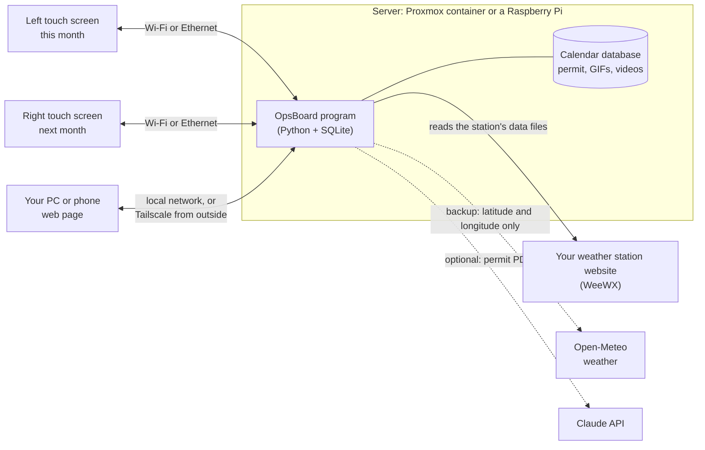

# OpsBoard: a two-screen touch calendar for a water and wastewater plant

OpsBoard is a small program you install on a Proxmox container or a Raspberry Pi. It drives two large
touch screens as a wall calendar (this month on the left, next month on the right) and gives you a web page
to manage the same calendar from your desk or phone.

## What it does

| You asked for | How OpsBoard does it |
|---|---|
| Two big touch screens as a calendar | `/display?screen=left` and `/display?screen=right`, full screen in a kiosk browser |
| Month rolls over by itself | At midnight on the 1st, the new month moves to the left screen and the next one to the right |
| Arrows to look back at old months | Arrows on both screens move both together; they snap back to today after 3 minutes |
| Add things from the touch screen | Tap a day, type with the built-in on-screen keyboard |
| Add things from a central web page | Same calendar at `/admin`, password protected |
| Upload the wastewater permit and water sample schedule | Stored on the Sampling tab; a spreadsheet import (or Claude, optionally, for PDFs) turns them into requirements you review |
| When to order bottles, when to pull | Every requirement gets an **ORDER** day and a **PULL** day on the calendar, plus a **DUE** marker on the deadline |
| 3-year samples spread out for the budget | The planner levels the cost across budget years and months, only uses allowed months, and finishes 6 months early to leave room for a resample |
| Several days off for Thanksgiving and Christmas | Tick "Day after Thanksgiving" or "Christmas Eve", or add your own holiday with a first and last day, once or every year |
| Notice days someone added to | A day gets an orange outline when an item is added, the on-call person is swapped for that day, or a sample pull is moved to it |
| Who works weekends and holidays | The on-call person's color and name are on every day; holidays are marked; the export counts weekend and holiday days per person |
| Weekly pay schedule | "PAY WK BEGINS", "PAY WK ENDS", and "PAYDAY" tags on the right days |
| Dropdown on each day: Jody, Marcus, Brandon | Pick someone on a Thursday and they fill through Wednesday; Jody and Marcus then alternate by themselves; Brandon covers a week or a day only when picked |
| GIFs based on current conditions | Upload GIFs per kind of weather; the one matching the weather outside shows next to the temperature |
| Something moving that matches the weather | Rain, snow, drifting clouds, fog, sun, moon and stars, or blown leaves cross the calendar, driven by your own weather station's readings and wind (seasonal leaves, snow, petals, bubbles are still available, or off) |
| Guard against image retention | Besides the moving weather, the whole picture shifts a few pixels every few minutes, and the screens switch off outside work hours |
| Screens dark outside work hours | Black page plus real monitor power-off; a tap wakes it for 5 minutes |
| Videos between dates you choose | Upload a video with a first day, last day, and how often; it plays full screen and a tap closes it |
| Markdown export | Any date range, past or future, from the Export tab |

## How the pieces fit



## Which hardware to build

Prices checked **November 14, 2026** (screens and touch frames re-checked November 19). Touch monitors and Raspberry Pis both cost noticeably more than a year ago,
so confirm prices before ordering. Full parts lists with links are in each variant's page.

**Ordering?** Start with the [ordering checklist](docs/ordering-checklist.md).
**Note:** the Elo 4303L in Variant D is discontinued; only leftover stock remains.

| | **A. Recommended** | B. Budget | C. Middle | D. Premium | E. Off the shelf |
|---|---|---|---|---|---|
| Screens | 2 x 32" ViewSonic TD3207 touch monitors | 2 x 32" monitors + stick-on IR touch frames | Same as B | 2 x 43" Elo 4303L touch displays | 2 x 27" Skylight Calendar Max |
| Computers | Server on Proxmox, one Pi 5 behind each screen | One Pi 5 runs everything | Server on Proxmox, one Pi 5 behind each screen | Server on Proxmox, one Pi 5 behind each screen | Built in |
| Approx. total | **$2,420** | **$950** | **$1,060** | **$3,400** | $1,200 + subscription |
| Meets the 28" minimum | Yes (32") | Yes (32") | Yes (32") | Yes (43") | No (27") |
| Runs this program | Yes | Yes | Yes | Yes | **No** |
| Touch works with wet or gloved hands | Yes (IR) | Yes (IR) | Yes (IR) | Bare or thin-glove (capacitive) | Bare finger |
| Rated to run all day, every day | Yes, 24/7 | No, office monitor | No, office monitor | Yes, 24/7 | Consumer |
| If one part fails | Other screen keeps working | Both screens stop | Other screen keeps working | Other screen keeps working | n/a |
| Setup effort | Low | Highest (touch mapping, frame fit) | Medium (frame fit) | Low, but heavy to hang | Lowest |
| Details | [Variant A](docs/variant-a-recommended.md) | [Variant B](docs/variant-b-budget.md) | [Variant C](docs/variant-c-middle.md) | [Variant D](docs/variant-d-premium.md) | see below |

**Recommendation: Variant A.** You already run Proxmox, so the server costs nothing and gets snapshots and backups.
One small Pi per screen avoids the fiddliest part of a two-touch-screen build (telling one computer which touch
panel belongs to which monitor), and a failed Pi or SD card only takes down one screen. The TD3207 is built to stay
on all day, its infrared touch works with wet or gloved hands, and the touch layer is part of the monitor instead
of a frame stuck to the front.

**If $2,400 is too much, build Variant C.** It is the same software and the same reliable layout for well under
half the price. The trade is office-grade monitors and stick-on touch frames that you have to size and align yourself.

**Starting with one screen.** Every variant can start with a single screen and gain the second later with no change
to the server: about $1,235 now for Variant A, or about $555 for Variant C. See
[Start with one screen](docs/start-with-one-screen.md).

**Variant E** is listed for honesty. A Skylight is a polished family calendar, but it is 27", needs a subscription
for some features, and cannot do the permit planning, the Thursday rotation, the pay tags, or the two-month layout.

## Try it on any computer first (5 minutes)

```bash
python3 -m venv .venv
```

```bash
.venv/bin/pip install -r requirements.txt
```

```bash
.venv/bin/uvicorn app.main:app --port 8080
```

Then open `http://localhost:8080/admin`, and `http://localhost:8080/display?screen=left` for a wall screen.
Outside work hours the wall screen is black by design: click it to wake it, or change the hours under Settings.

## Build order

1. Pick a variant above and order the parts from its page (or [half of them, for one screen](docs/start-with-one-screen.md)).
2. [Install the server](docs/server-setup.md) (Proxmox container, Raspberry Pi, or Docker).
3. [Mount the screens](docs/mounting.md).
4. [Set up the wall-screen computer(s)](docs/kiosk-setup.md).
5. [Set up remote access](docs/remote-access.md) if you want the web page away from the plant.
6. [Enter your schedule and learn the daily routine](docs/using-opsboard.md).

## What is in this repository

```
app/                 the program (Python, FastAPI, SQLite) and its web pages
  static/            wall screen, web page, on-screen keyboard, weather effects
tests/               automated tests for the rotation, holidays, sample planner, import, export
deploy/              server install script, systemd service, backup script
kiosk/               wall-screen install script and launcher for a Pi or mini PC
docs/                step-by-step guides, one per variant plus setup and use
diagrams/            wiring and wall-layout drawings (SVG)
samples/             spreadsheet template for the sampling requirements
Dockerfile, docker-compose.yml, .env.example
```

## What has and has not been tested

- **Tested:** the program itself. The automated tests pass (`pytest`), and the wall screens, day dialog,
  on-screen keyboard, sampling tab, uploads, export, and password sign-in were exercised in a browser at 1920x1080.
- **Not tested on real hardware:** the scripts in `kiosk/` and `deploy/` were checked for shell syntax only. They
  have not been run on a Raspberry Pi or a Proxmox container. Expect to adjust small things, most likely in
  two-screen touch mapping (Variant B) and monitor power-off.
- **Not tested:** reading a permit PDF with Claude. It needs your API key, and every draft it produces must be
  checked against the permit before you add it.

OpsBoard is a planning aid. Your permit and your state's monitoring schedule are the authority on what is due and when.

## License

MIT. See [LICENSE](LICENSE).
