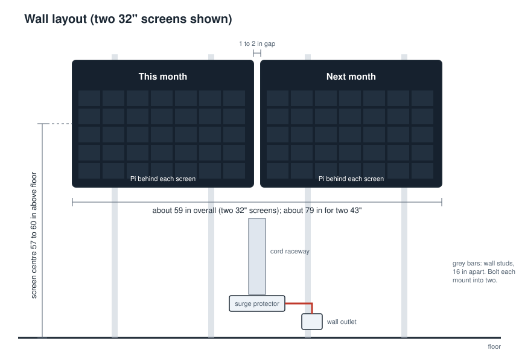

# Mounting the screens

## Where

- **Height:** put the centre of the screens about 57 to 60 inches from the floor. Everyone should be able to touch
  the top row of days without stretching and the bottom row (the on-call dropdowns) without bending.
- **Gap:** leave 1 to 2 inches between the two screens. Left screen = this month, right screen = next month.
- **Width needed:** two 32" screens are about 59 inches across with the gap. Two 43" screens are about 79 inches.
- **Light:** avoid a wall that faces a window. Glare washes out the picture, and direct sun can confuse infrared touch.
- **Power and network:** within 6 feet of an outlet. Check the Wi-Fi signal there with your phone, or plan an Ethernet run.
- **Environment:** a dry office or control room. Not the chemical room, not the lab bench wall, not outdoors.

## Steps

1. Find and mark the studs across the whole span with the stud finder. Confirm each with a small nail hole where the mount will cover it.
2. Mark the centre height line (57 to 60 inches) lightly in pencil, using the level.
3. Hold the left wall plate on the line so that at least two lag bolts land in studs. Mark the holes.
4. Drill 3/16" pilot holes about 2.5 inches deep into the studs.
5. Bolt the left wall plate on, snug but not crushed into the drywall. Check it with the level before the final turn.
6. Measure across for the right plate: screen width plus your gap, centre to centre. Use the level to carry the height over. A 1/8 inch height mismatch between two screens side by side is easy to see, so take your time here.
7. Mark, drill, and bolt the right plate the same way.
8. Screw the mount's brackets to the back of each monitor with the correct VESA screws (usually M4 for 32", M6 for 43"). Hand tight only.
9. With two people, hang each monitor on its plate and engage the safety catch or locking screw.
10. Stick the Pi (in its case) to the back of the monitor or to the wall beside the mount, where air can move around it. Do not cover the monitor's vents.
11. Connect HDMI, the USB touch cable, and power. Leave a little slack so the screens can tilt.
12. Mount the surge protector low on the wall or on the floor, run the cords down in the raceway, and plug in.

## After mounting

- Wipe the screens with a dry microfibre cloth. For fingerprints use a cloth barely damp with water. No ammonia or solvent cleaners.
- For stick-on IR frames, brush dust out of the inner edge of the frame once a month.
