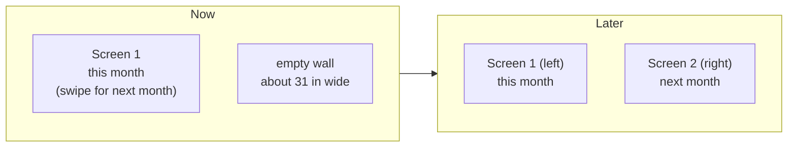

# Start with one screen, add the second later

OpsBoard does not need both screens. One screen shows the current month, and a swipe (or the arrows) shows next
month. When you add the second screen later, nothing on the server changes: the new screen simply shows next month.

Prices checked **November 14, 2026**.

## What to buy now, and what to buy later

| Variant | Now (one screen) | Later (second screen) | Parts lists |
|---|---|---|---|
| **A. Recommended** | about **$1,235** | about $1,185 | [Variant A](variant-a-recommended.md) |
| B. Budget (one Pi for both) | about $570 | about $380 | [Variant B](variant-b-budget.md) |
| C. Middle | about **$555** | about $505 | [Variant C](variant-c-middle.md) |
| D. Premium | about $1,700 | about $1,700 | [Variant D](variant-d-premium.md) |

**Now:** from the variant's parts list, buy one of everything listed with quantity 2 (screen, Pi, power supply,
case, SD card, HDMI cable, wall mount, network cable), plus the one-off items (power strip, cord cover, hook-and-loop
strips). For Variant A that is:

| Part | Qty | Each | Where |
|---|---|---|---|
| ViewSonic TD3207, 32" touch monitor | 1 | $1,029.99 | [product page](https://www.viewsonic.com/us/td3207.html) |
| Raspberry Pi 5, 2 GB | 1 | $77.50 | [product page](https://www.raspberrypi.com/products/raspberry-pi-5/) |
| Raspberry Pi 27W USB-C power supply | 1 | $12.00 | [product page](https://www.raspberrypi.com/products/27w-power-supply/) |
| Raspberry Pi 5 case | 1 | $10.00 | [product page](https://www.raspberrypi.com/products/raspberry-pi-5-case/) |
| microSD card, 32 GB, A2 | 1 | $12.00 | [product page](https://www.raspberrypi.com/products/sd-cards/) |
| Micro-HDMI to HDMI cable, 1 m | 1 | $7.00 | [product page](https://www.raspberrypi.com/products/micro-hdmi-to-standard-hdmi-a-cable/) |
| Low-profile wall mount, VESA 100x100 to 400x400 | 1 | $30.00 | [search](https://www.amazon.com/s?k=low+profile+tv+wall+mount+vesa+100x100+to+400x400) |
| Surge-protector power strip, 6 outlet | 1 | $20.00 | [search](https://www.amazon.com/s?k=surge+protector+power+strip+6+outlet) |
| Cord cover / raceway kit | 1 | $20.00 | [search](https://www.amazon.com/s?k=cord+cover+raceway+kit+wall) |
| Hook-and-loop strips | 1 | $8.00 | [search](https://www.amazon.com/s?k=industrial+hook+and+loop+adhesive+strips) |
| Ethernet patch cable (optional) | 1 | $8.00 | [search](https://www.amazon.com/s?k=cat6+ethernet+patch+cable+10ft) |
| **Total** | | **about $1,235** | |

**Later:** buy the second of each quantity-2 item. Buy the same monitor model if it is still sold, so the two
screens match in size, height and colour. If the model has been replaced, match the size and the VESA mount pattern.

## Layout: leave room for the second screen



## Steps now

1. [Install the server](server-setup.md) exactly as written. It is the same for one screen or two.
2. Decide where both screens will eventually go, following [mounting.md](mounting.md). Mark both positions on the
   wall in pencil.
3. Mount the first screen in the **left** position. Leave the right position empty: about 31 inches of clear wall
   for a 32" screen (the screen plus a 1 to 2 inch gap), or about 41 inches for a 43" screen.
4. Put the power strip where its cord reaches both positions, and run the cord cover far enough to serve the
   second screen later.
5. Set up the Pi as in [kiosk-setup.md](kiosk-setup.md), using `left` as the screen:
   ```bash
   bash ~/opsboard-repo/kiosk/install-kiosk.sh http://192.168.1.50:8080 left YOUR_SCREEN_TOKEN
   ```
6. Test: the screen shows this month. Swipe left for next month; it returns to this month after 3 minutes.

## Steps later, when the second screen arrives

1. Mount it on the right, level with the first (see step 6 of the mounting guide: a 1/8 inch height mismatch shows).
2. **Variants A, C, D (one Pi per screen):** set up the new Pi the same way, with `right` in place of `left`:
   ```bash
   bash ~/opsboard-repo/kiosk/install-kiosk.sh http://192.168.1.50:8080 right YOUR_SCREEN_TOKEN
   ```
3. **Variant B (one Pi drives both):** plug the second monitor and its touch cable into the same Pi, then re-run
   the installer with `both` and follow the two-screen section of [kiosk-setup.md](kiosk-setup.md):
   ```bash
   bash ~/opsboard-repo/kiosk/install-kiosk.sh http://localhost:8080 both YOUR_SCREEN_TOKEN
   ```
4. Test: swipe on either screen and both move together; tap a day on each and check the touch lands on the right screen.

Nothing in the calendar, the sampling plan or the settings needs to change.
