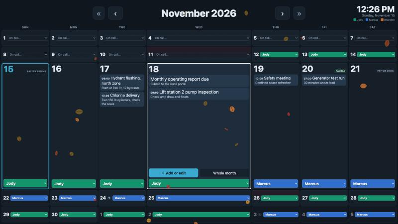
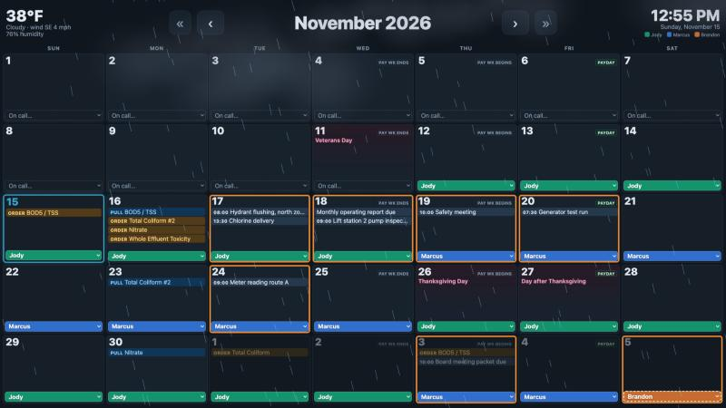

# Using OpsBoard

## First-time setup (about 30 minutes, on the web page)

1. **Settings.** Set the work days and hours (the screens are dark outside them), the latitude and longitude of
   the plant (for the weather), which weekdays you pull samples, and the month your budget year starts.
2. **Staff & pay.** Check the three names and colors. Jody and Marcus have "In rotation" checked; Brandon does not.
   Set the day the pay week begins and the payday. Uncheck any federal holidays you do not observe.
   For the extra days off around Thanksgiving and Christmas, tick **Day after Thanksgiving**, **Christmas Eve**,
   **Day after Christmas** or **New Year's Eve**; these land on the right date every year. For anything else, add
   your own holiday with a first day and, for several days in a row, a last day. Leave the name empty and it is
   called "Holiday". Tick **Same dates every year** if it repeats.
3. **Calendar.** Find the next Thursday and pick whoever is on call that week from the dropdown at the bottom of
   the day. That week fills in, and every week after it alternates by itself.
4. **Sampling.** Upload the permit and the state sample schedule so they are on file. Then enter the requirements
   (next section).
5. **GIFs & videos.** Upload a few GIFs for each kind of weather.

## The on-call dropdown

| You do this | What happens |
|---|---|
| Pick Jody or Marcus on a **Thursday** | They are on call Thursday through the next Wednesday. The following week goes to the other one, and so on, forever. Earlier weeks do not change. |
| Pick Brandon on a **Thursday** | Brandon covers that whole week. The Jody/Marcus rotation continues underneath as if nothing happened. |
| Pick anyone on **another day** | Only that day changes (a dashed outline marks it). |
| Pick **Auto (rotation)** | Removes the manual choice: the whole week if you do it on Thursday, otherwise that day. |

The first day of the on-call week, the rotation members, and their order can be changed under **Staff & pay**.

## Sampling requirements

A requirement is one line: *what* to sample, *how often*, and *what each sample costs*.

1. Easiest: on the Sampling tab click **Download the spreadsheet template**, fill in one row per requirement from
   your permit and sample schedule, and **Import spreadsheet**. Review the drafts and click **Add checked to calendar**.
   You can also add them one at a time with **Add a requirement**.
2. The important columns:
   - **How often:** weekly, monthly, quarterly, twice a year, yearly, every 3, 6, or 9 years, or one time.
   - **First day of the current period:** for 3-year drinking water samples this is the first day of the
     compliance period on your schedule, for example 2026-01-01 for the 2026 to 2028 period.
   - **Months allowed:** for samples that must be taken in certain months (lead and copper is often June to September).
   - **Cost of each sample:** this is what the planner balances.
   - **Order bottles this many days ahead:** how long your lab takes to get bottles to you. 0 means no reminder.
3. The planner then puts three things on the calendar for each sample:
   - **ORDER** (amber): the day to order bottles.
   - **PULL** (blue): the day to pull the sample.
   - **DUE** (red): the last day of the window, for anything yearly or longer, until it is marked pulled.

### How the planner picks dates

- Weekly and monthly samples are spaced evenly inside each week or month.
- Everything else goes on that month's **sampling day** (the first allowed weekday on or after the 8th), so samples
  due the same month share one bottle order and one trip to the lab.
- For 3-year and other long windows it chooses the month that keeps the **cost per budget year** level first, then
  the cost per month, using only allowed months, and finishing at least 6 months before the deadline.
- It never schedules on a holiday or a weekday you have not allowed.

### Things to do when you first enter requirements

- **Already pulled this period?** The planner does not know. Open the planned date on the Sampling tab and click
  **Pulled** (it records today; to record the real date, open that day on the calendar and use Mark pulled there).
- **Do not like a date?** Type a new one and click **Move**. A moved date is pinned and is never changed by the planner.
- **Added several requirements and want a fresh, even plan?** Click **Re-balance the plan**. Pinned, ordered, and
  pulled samples stay put.

The **Cost by budget year** table at the bottom shows what the plan will cost each year.

### Reading the permit automatically

If an Anthropic API key is set on the server ([server-setup.md](server-setup.md)), **Read requirements** next to an
uploaded PDF asks Claude to list the sampling requirements. They arrive as drafts. **Check every line against the
permit** before adding it: frequencies and monitoring periods in permits are easy to misread, and a wrong draft that
you approve becomes a wrong date on the wall.

## Day to day on the wall

- **Add something:** tap the day, tap Title, type, tap **Add to calendar**.
- **Orange outline:** a day gets an orange outline when someone has changed it by hand: an item was added, a
  different person was picked for that day in place of the rotation, or a sample pull was moved to that day. The
  normal rotation and the planner's own sampling dates do not count, so the outline shows what is out of the routine.
- **Mark a day as a holiday:** tap the day, then **Mark as holiday**. **Remove holiday** takes it off again.
- **Mark bottles ordered or a sample pulled:** tap the day, then the button on that line.
- **Change month:** swipe left for later months or right for earlier ones, or tap the single arrows. Both screens move together. They return to the current month after 3 minutes, or tap **Back to today**.
- **Change year:** swipe with two fingers, or tap the double arrows.
- **See a week up close:** tap a day. Its week grows to fill most of the screen, with full titles and notes, and the day you tapped is widest. Tap another day to move, tap the same day again (or **Add or edit**) to add or change items, and tap **Whole month** to go back. The screen goes back by itself after 2 minutes.

  
- **Try it from a desk:** open `/preview` on the server to see both wall screens side by side in one browser window.
- **After hours:** the screens are off. A tap turns them on for 5 minutes.

## GIFs and videos

- **Weather from your own station:** under **Settings > Weather**, enter the address of your weather station's
  website. It must be a WeeWX site using the Belchertown skin, which publishes the data files OpsBoard reads
  (`/json/weewx_data.json`, and `/json/forecast.json` for sky cover if forecasts are switched on). Press
  **Check the weather now** to see the reading and where it came from. The latitude and longitude are a backup:
  they are only used if the station has not reported for 30 minutes.
- **Moving weather over the calendar:** with the effect set to **Follow the weather right now**, the wall shows what
  is happening outside, and the wind speed and direction from the station push it across the screen:

  | Outside | On the wall |
  |---|---|
  | Clear day / clear night | A sun crossing with drifting specks of light / a moon crossing with twinkling stars |
  | Partly cloudy, cloudy | A few or many soft clouds drifting with the wind |
  | Rain | Darker clouds and rain streaks, heavier as the station's rain rate rises, slanted by the wind |
  | Snow | Clouds and snowflakes blown sideways by the wind |
  | Thunderstorm | Heavy rain with a soft flash now and then |
  | Fog | Wide bands of mist drifting slowly |
  | Windy (18 mph, or gusts of 25) | Leaves blowing across, added to whatever the sky is doing |
  | Bitter cold (15 F or below) | Drifting ice sparkles |

  

  The station's rain gauge decides rain (or snow, at 33 F and below). A rain gauge cannot see snow, fog or
  lightning, so those come from the nearest airport report that your station site already shows.
- **Image retention:** something is always moving, the whole picture shifts a few pixels every four minutes (switch
  this off under Settings if you dislike it), and the screens go off outside work hours. The monitors in every
  variant are LCDs, which do not burn in permanently the way OLED screens do; the worst case is a faint ghost that
  fades after the screen has been off for a while.
- **GIFs:** each is tagged with a kind of weather (clear, cloudy, rain, snow, thunderstorm, fog, windy, hot, bitter
  cold). The wall shows ones that match what is happening outside, changing every 45 seconds. Sites such as GIPHY let
  you download GIFs; make sure you have the right to display whatever you use at work.
- **Videos:** MP4 (H.264) plays most reliably on a Raspberry Pi. Keep them at 1080p or below. Choose the first and
  last day, how often it plays, and which screen. Videos set to both screens start together.

## Export

**Export** makes a Markdown file for any range. It lists the on-call weeks, holidays with who worked them, a count
of weekend and holiday days per person, pay weeks, every sampling date with its status and cost, and all events.
Use "Last 12 months" for an annual record, or "Next 3 years" to hand the sampling plan to whoever does the budget.
