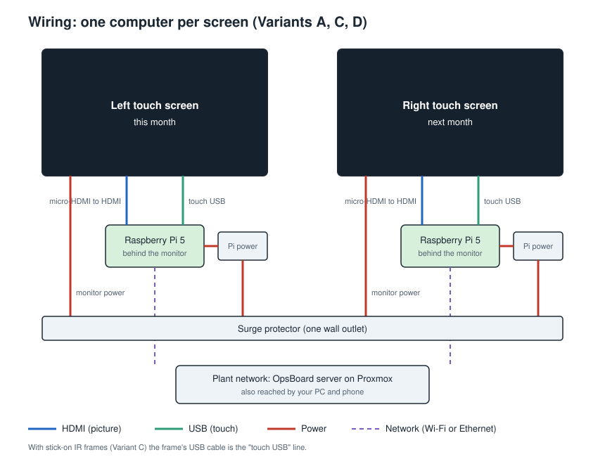
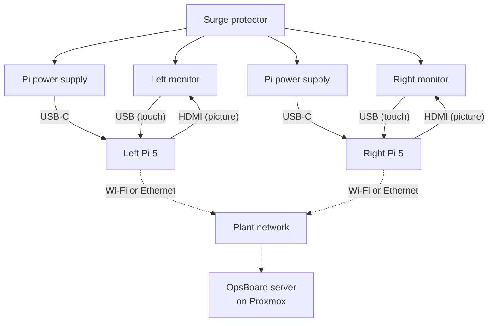

# Variant A (recommended): Proxmox server, a Pi behind each screen, ViewSonic touch monitors

**Why this one:** the screens are made for this job. The ViewSonic TD3207 is rated to run 24 hours a day, its
infrared touch works with wet or gloved fingers, and the touch layer is built in, so there is nothing to align.
The server lives on the Proxmox machine you already have, and each screen has its own small computer, so setup is
plug-in simple and one failure never blanks both screens.

**Trade-offs:** it is the second most expensive option, and almost all of the cost is the two monitors.

## Parts

Prices checked **November 14, 2026**. A link that goes to a search page means I could not confirm one exact product page; pick a listing with good reviews and the size shown.

| Part | Qty | Each | Total | Where |
|---|---|---|---|---|
| ViewSonic TD3207, 32" 1080p touch monitor (IR touch, rated 24/7) | 2 | $1,029.99 | $2,059.98 | [product page](https://www.viewsonic.com/us/td3207.html) |
| Raspberry Pi 5, 2 GB | 2 | $77.50 | $155.00 | [product page](https://www.raspberrypi.com/products/raspberry-pi-5/) |
| Raspberry Pi 27W USB-C power supply | 2 | $12.00 | $24.00 | [product page](https://www.raspberrypi.com/products/27w-power-supply/) |
| Raspberry Pi 5 case (has a fan) | 2 | $10.00 | $20.00 | [product page](https://www.raspberrypi.com/products/raspberry-pi-5-case/) |
| microSD card, 32 GB, A2 rated | 2 | $12.00 | $24.00 | [product page](https://www.raspberrypi.com/products/sd-cards/) |
| Micro-HDMI to HDMI cable, 1 m | 2 | $7.00 | $14.00 | [product page](https://www.raspberrypi.com/products/micro-hdmi-to-standard-hdmi-a-cable/) |
| Low-profile wall mount, VESA 100x100 to 400x400 | 2 | $30.00 | $60.00 | [search](https://www.amazon.com/s?k=low+profile+tv+wall+mount+vesa+100x100+to+400x400) |
| Surge-protector power strip, 6 outlet | 1 | $20.00 | $20.00 | [search](https://www.amazon.com/s?k=surge+protector+power+strip+6+outlet) |
| Paintable cord cover / raceway kit | 1 | $20.00 | $20.00 | [search](https://www.amazon.com/s?k=cord+cover+raceway+kit+wall) |
| Adhesive hook-and-loop strips (to fix the Pi behind the monitor) | 1 | $8.00 | $8.00 | [search](https://www.amazon.com/s?k=industrial+hook+and+loop+adhesive+strips) |
| Ethernet patch cable (optional, steadier than Wi-Fi) | 2 | $8.00 | $16.00 | [search](https://www.amazon.com/s?k=cat6+ethernet+patch+cable+10ft) |
| **Total** | | | **about $2,420** | |

The TD3207 comes with its own USB touch cable and power cord. Check its VESA hole pattern on the spec sheet before buying mounts. A Raspberry Pi 4 (2 GB, about $67.50) also works if Pi 5 stock is short; it needs a different power supply, case, and the same micro-HDMI cable.

## Tools

- Stud finder, pencil, 4 ft level, tape measure
- Drill with a 3/16" bit (wood studs) and a Phillips driver bit
- Socket or wrench for the lag bolts that come with the mounts
- PC with an SD card reader; USB keyboard and mouse for first setup
- A second person for hanging the screens

## Safety

- Bolt the mounts into **wall studs** (or use anchors rated for the wall type and three times the screen weight). Drywall alone will not hold a monitor.
- Check for wires and pipes before drilling. Do not drill directly above or below an outlet or switch.
- Keep the screens, power strip, and computers out of splash zones and away from chemical feed rooms. These are indoor office electronics. Chlorine and humid air corrode them.
- Plug everything into one surge protector on a normal outlet. Do not run power cords inside the wall; use the raceway on the surface, or have an electrician add an outlet behind the screens.
- Lift with two people, and never carry a monitor by its screen face.

## Wiring

## Step by step

1. Order every part in the list above. While you wait, put this repository on GitHub.
2. Install the server in a Proxmox container: [server-setup.md, option 1](server-setup.md). Write down the address, password, and screen token.
3. From your PC, open the server's web page, sign in, and set your work hours and location under **Settings**.
4. Decide the wall position. See [mounting.md](mounting.md) for the layout drawing and heights.
5. Hang both wall mounts, level with each other, following [mounting.md](mounting.md).
6. Before hanging the monitors, set up the wall-screen computer(s) on a table: follow [kiosk-setup.md](kiosk-setup.md) using `left` on one Pi and `right` on the other. It is much easier to fix a cable on a table than on the wall.
7. Confirm the calendar comes up full screen and touch works on each screen.
8. Power everything down. Attach the mount brackets to the monitors and hang them.
9. Fix each computer behind its monitor with hook-and-loop strips, clear of the vents.
10. Connect the cables as shown in the wiring diagram below, and tidy them into the raceway.
11. Power up and run the tests.

## Testing

1. Both screens show the calendar within a minute of power-on, left = this month, right = next month.
2. Tap a day on each screen, add an event with the on-screen keyboard, and see it on the web page.
3. Change the on-call name on a Thursday and confirm it fills through Wednesday.
4. Tap an arrow: both screens move together and return to today after 3 minutes.
5. Pull the power strip's plug for ten seconds and plug it back in. Everything should come back by itself.

## Calibration

- Touch accuracy, wrong-screen touch, and monitors that will not wake: see the table in [kiosk-setup.md](kiosk-setup.md).
- Brightness: set each monitor's own brightness with its buttons so the two match. Around 60 percent is comfortable indoors and extends backlight life.
- Work hours, weather station, moving effect, and GIF timing: **Settings** on the web page.

Then enter your real schedule: [using-opsboard.md](using-opsboard.md).
