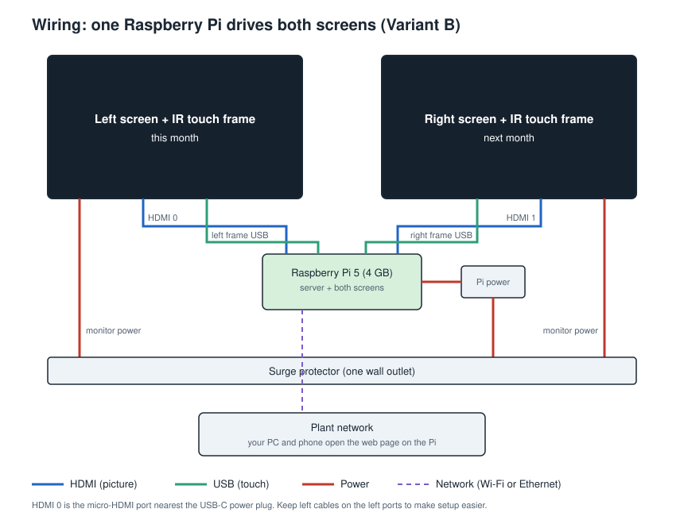
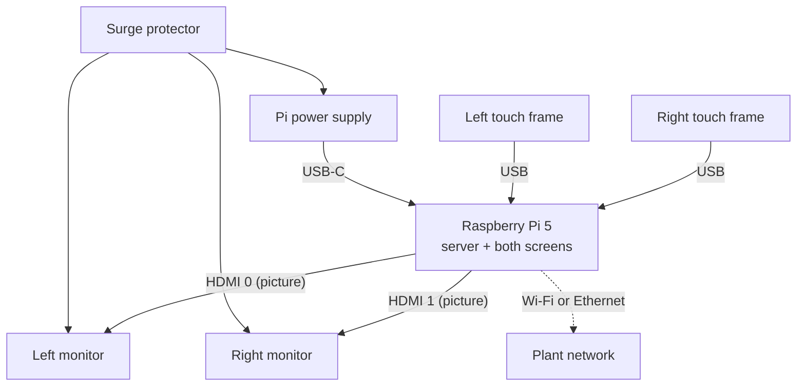

# Variant B (budget): one Raspberry Pi runs everything

**Why this one:** the lowest cost and no other computer needed. One Raspberry Pi 5 runs the server and drives both
screens from its two HDMI ports.

**Trade-offs:**
- Everything depends on one Pi and one SD card. If either fails, both screens and the web page are down, so off-device backups matter.
- One computer has to be told which touch panel belongs to which monitor. The launcher does this, but identical frames can come up in either order, so expect to flip `SWAP_TOUCH` once. This is the least-proven part of the whole project.
- It uses the older X11 desktop, because that is what makes two-screen touch mapping reliable.
- The same stick-on touch frame trade-offs as Variant C, including the unproven Raspberry Pi support. Read [Will the touch frame work on a Pi 5?](variant-c-middle.md#will-the-touch-frame-work-on-a-pi-5) before ordering.
- Both screens must be within cable reach of the one Pi (use 2 m HDMI cables if they are far apart).

It saves only about $100 over Variant C, so choose it only if you have no Proxmox host to put the server on, which you do. It is here mainly as the stand-alone option.

## Parts

Prices checked **November 14, 2026**. A link that goes to a search page means I could not confirm one exact product page; pick a listing with good reviews and the size shown.

| Part | Qty | Each | Total | Where |
|---|---|---|---|---|
| ViewSonic VA3209M, 32" 1080p monitor (VESA 100x100) | 2 | $149.99 | $299.98 | [product page](https://www.viewsonic.com/us/products/va3209m.html) |
| 32" infrared touch frame overlay, USB, 10-point | 2 | $200.00 | $400.00 | [search](https://www.amazon.com/s?k=32+inch+infrared+touch+frame+overlay+USB) |
| Raspberry Pi 5, 4 GB (price varies, $85 to $110) | 1 | $100.00 | $100.00 | [product page](https://www.raspberrypi.com/products/raspberry-pi-5/) |
| Raspberry Pi 27W USB-C power supply | 1 | $12.00 | $12.00 | [product page](https://www.raspberrypi.com/products/27w-power-supply/) |
| Raspberry Pi 5 case (has a fan) | 1 | $10.00 | $10.00 | [product page](https://www.raspberrypi.com/products/raspberry-pi-5-case/) |
| microSD card, 32 GB, A2 rated | 1 | $12.00 | $12.00 | [product page](https://www.raspberrypi.com/products/sd-cards/) |
| Micro-HDMI to HDMI cable, 1 m | 2 | $7.00 | $14.00 | [product page](https://www.raspberrypi.com/products/micro-hdmi-to-standard-hdmi-a-cable/) |
| Low-profile wall mount, VESA 100x100 to 400x400 | 2 | $30.00 | $60.00 | [search](https://www.amazon.com/s?k=low+profile+tv+wall+mount+vesa+100x100+to+400x400) |
| Surge-protector power strip, 6 outlet | 1 | $20.00 | $20.00 | [search](https://www.amazon.com/s?k=surge+protector+power+strip+6+outlet) |
| Paintable cord cover / raceway kit | 1 | $20.00 | $20.00 | [search](https://www.amazon.com/s?k=cord+cover+raceway+kit+wall) |
| Adhesive hook-and-loop strips (to fix the Pi behind the monitor) | 1 | $8.00 | $8.00 | [search](https://www.amazon.com/s?k=industrial+hook+and+loop+adhesive+strips) |
| **Total** | | | **about $960** | |

## Tools

- Stud finder, pencil, 4 ft level, tape measure
- Drill with a 3/16" bit (wood studs) and a Phillips driver bit
- Socket or wrench for the lag bolts that come with the mounts
- PC with an SD card reader; USB keyboard and mouse for first setup
- A second person for hanging the screens
- Isopropyl alcohol and a lint-free cloth for the frame adhesive

## Safety

- Bolt the mounts into **wall studs** (or use anchors rated for the wall type and three times the screen weight). Drywall alone will not hold a monitor.
- Check for wires and pipes before drilling. Do not drill directly above or below an outlet or switch.
- Keep the screens, power strip, and computers out of splash zones and away from chemical feed rooms. These are indoor office electronics. Chlorine and humid air corrode them.
- Plug everything into one surge protector on a normal outlet. Do not run power cords inside the wall; use the raceway on the surface, or have an electrician add an outlet behind the screens.
- Lift with two people, and never carry a monitor by its screen face.

## Wiring

## Step by step

1. Order every part in the list above. While you wait, put this repository on GitHub.
2. Skip for now. In this variant the server goes on the Pi itself, and you install it during step 6.
3. From your PC, open the server's web page, sign in, and set your work hours and location under **Settings**.
   - **Before ordering the touch frames,** measure the monitors as described in [Variant C](variant-c-middle.md), and fit the frames the same way.
4. Decide the wall position. See [mounting.md](mounting.md) for the layout drawing and heights.
5. Hang both wall mounts, level with each other, following [mounting.md](mounting.md).
6. Before hanging the monitors, set up the wall-screen computer(s) on a table: follow [kiosk-setup.md](kiosk-setup.md) using `both`. It is much easier to fix a cable on a table than on the wall.
7. Confirm the calendar comes up full screen and touch works on each screen.
8. Power everything down. Attach the mount brackets to the monitors and hang them.
9. Fix each computer behind its monitor with hook-and-loop strips, clear of the vents.
10. Connect the cables as shown in the wiring diagram below, and tidy them into the raceway.
11. Power up and run the tests.

## Testing

1. Both screens show the calendar within a minute of power-on, left = this month, right = next month.
2. Tap a day on each screen, add an event with the on-screen keyboard, and see it on the web page.
3. Change the on-call name on a Thursday and confirm it fills through Wednesday.
4. Tap an arrow: both screens move together and return to today after 3 minutes.
5. Pull the power strip's plug for ten seconds and plug it back in. Everything should come back by itself.
6. Touch each screen in turn and confirm the tap lands on the screen you touched. If not, set `SWAP_TOUCH=1` ([kiosk-setup.md](kiosk-setup.md)).

## Calibration

- Touch accuracy, wrong-screen touch, and monitors that will not wake: see the table in [kiosk-setup.md](kiosk-setup.md).
- Brightness: set each monitor's own brightness with its buttons so the two match. Around 60 percent is comfortable indoors and extends backlight life.
- Work hours, weather station, moving effect, and GIF timing: **Settings** on the web page.

Then enter your real schedule: [using-opsboard.md](using-opsboard.md).
