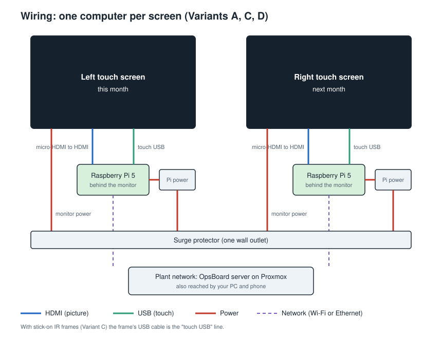
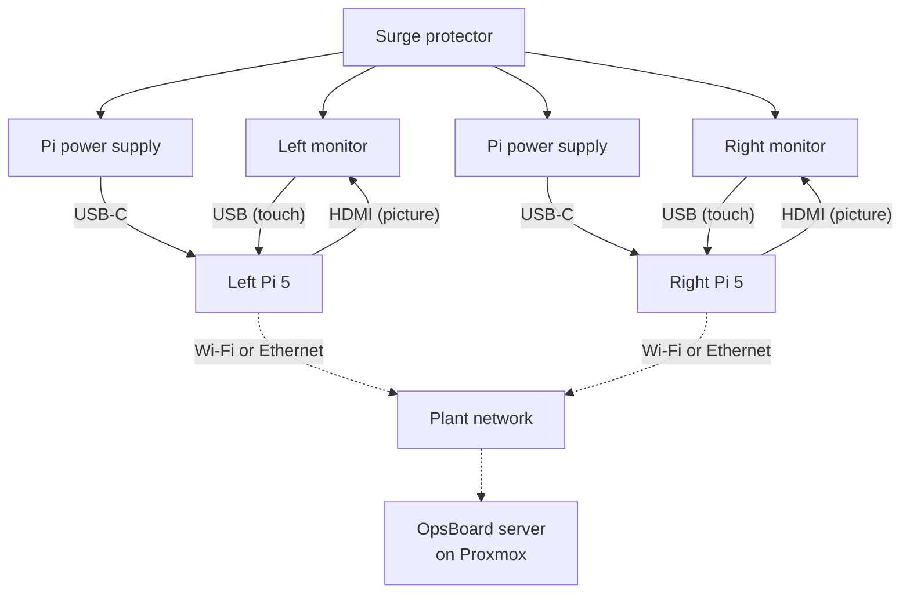

# Variant C (middle): Proxmox server, a Pi behind each screen, monitors with stick-on touch frames

**Why this one:** the same dependable layout as Variant A for less than half the money. The saving comes from
using ordinary 32" monitors and adding an infrared touch frame to the front of each.

**Trade-offs:**
- The frames are generic imports. Quality varies, and the frame must match your monitor's picture size. **Measure before ordering** (step 1 below).
- The monitors are office grade, not rated for all-day use. Expect a shorter life than Variant A; a replacement is $150.
- A frame adds a raised bezel about half an inch deep around the screen. Dust or a spider on the sensors can cause phantom touches; wipe the inner edge monthly.
- **Raspberry Pi support for these frames is not guaranteed.** See [Will the touch frame work on a Pi 5?](#will-the-touch-frame-work-on-a-pi-5) below before ordering.

## Parts

Prices checked **November 14, 2026**. A link that goes to a search page means I could not confirm one exact product page; pick a listing with good reviews and the size shown.

| Part | Qty | Each | Total | Where |
|---|---|---|---|---|
| ViewSonic VA3209M, 32" 1080p monitor (VESA 100x100) | 2 | $149.99 | $299.98 | [product page](https://www.viewsonic.com/us/products/va3209m.html) |
| 32" infrared touch frame overlay, USB, 10-point | 2 | $200.00 | $400.00 | [search](https://www.amazon.com/s?k=32+inch+infrared+touch+frame+overlay+USB) |
| Raspberry Pi 5, 2 GB | 2 | $77.50 | $155.00 | [product page](https://www.raspberrypi.com/products/raspberry-pi-5/) |
| Raspberry Pi 27W USB-C power supply | 2 | $12.00 | $24.00 | [product page](https://www.raspberrypi.com/products/27w-power-supply/) |
| Raspberry Pi 5 case (has a fan) | 2 | $10.00 | $20.00 | [product page](https://www.raspberrypi.com/products/raspberry-pi-5-case/) |
| microSD card, 32 GB, A2 rated | 2 | $12.00 | $24.00 | [product page](https://www.raspberrypi.com/products/sd-cards/) |
| Micro-HDMI to HDMI cable, 1 m | 2 | $7.00 | $14.00 | [product page](https://www.raspberrypi.com/products/micro-hdmi-to-standard-hdmi-a-cable/) |
| Low-profile wall mount, VESA 100x100 to 400x400 | 2 | $30.00 | $60.00 | [search](https://www.amazon.com/s?k=low+profile+tv+wall+mount+vesa+100x100+to+400x400) |
| Surge-protector power strip, 6 outlet | 1 | $20.00 | $20.00 | [search](https://www.amazon.com/s?k=surge+protector+power+strip+6+outlet) |
| Paintable cord cover / raceway kit | 1 | $20.00 | $20.00 | [search](https://www.amazon.com/s?k=cord+cover+raceway+kit+wall) |
| Adhesive hook-and-loop strips (to fix the Pi behind the monitor) | 1 | $8.00 | $8.00 | [search](https://www.amazon.com/s?k=industrial+hook+and+loop+adhesive+strips) |
| Ethernet patch cable (optional, steadier than Wi-Fi) | 2 | $8.00 | $16.00 | [search](https://www.amazon.com/s?k=cat6+ethernet+patch+cable+10ft) |
| **Total** | | | **about $1,060** | |

### Monitor option: Samsung Odyssey G5 G50F (32")

If the ViewSonic is out of stock, the Samsung Odyssey G5 G50F 32" (US model LS32FG502ENXZA) is a good substitute.
It is 2560x1440, VESA 100x100, and has a height-adjustable stand you will not need on the wall.
List price is $349.99. On November 19, 2026 it was $209.99 at [Newegg](https://www.newegg.com/samsung-ls32fg502enxza-32-qhd-max-180-hz-ips-black/p/N82E16824027385)
and $219.99 at Amazon; Samsung.com and B&H were at full price. Do not confuse it with the G51F, a different model often on sale for less.
At $210 each the total rises by about $120, to about $1,180. The Pi will drive it at 1080p or 1440p; OpsBoard looks the same at either.
Its picture area is the same as any 32" 16:9 panel, so the frame sizing below still applies. Measure the bezel anyway, as it differs from the ViewSonic.
[Best Buy listing](https://www.bestbuy.com/site/6667827.p)

### Touch frame brand: GreenTouch

GreenTouch is the most common brand of 32" IR frame in US listings. On November 19, 2026, 32" 10-point USB frames
were $166 to $350 on eBay and $189 to $259 on Newegg (frame only, no glass). A version with safety glass and a mounting
bar is about $575 from Tycotouch. The $200 in the parts list is a fair middle figure.
Read the next section first: several GreenTouch listings say outright that the frame does not support Raspberry Pi.

## Will the touch frame work on a Pi 5?

**Not proven. Plan for it to fail and buy where returns are easy.**

What the research shows (November 2026):
- Several GreenTouch listings say the frame **does not support Raspberry Pi**. One says the manufacturer has no Linux drivers.
- Other GreenTouch listings say it is "driver free" on native Linux. The claims contradict each other.
- No one was found running a GreenTouch frame on a Pi.
- The frames claim to be standard USB HID touch devices. If that is true, the Pi's built-in `hid-multitouch` driver should handle it with no extra software. That is the reason it *might* work.
- Elo states that its own IR and capacitive touch products use standard HID and should work on a Raspberry Pi with no driver ([Elo support](https://elosupport.elotouch.com/hc/en-us/articles/31649853461271-Do-Elo-Products-support-Raspberry-Pi-devices)). That is the only maker found that says so in writing.

**If you want a proven-by-the-maker option instead:** the Elo 3203L (part E720061) is a 32" monitor with capacitive touch built in, about $970 to $1,850 depending on seller (CDW listed $1,290). Two of them replace both monitors and both frames. It brings the build to about $2,800, so at that point compare it with [Variant A](variant-a-recommended.md). Note: capacitive touch needs a bare finger or thin glove; IR works with any glove.

### Bench test the frame before mounting anything

Do this on a table with one Pi 5 set up per [kiosk-setup.md](kiosk-setup.md), within the seller's return window.

1. Plug in the frame's USB cable and run `lsusb`. A new line should appear for the frame.
2. Run `sudo dmesg | tail -20`. Look for `hid-multitouch` and an `input:` line naming the frame. If you only see `hid-generic` or nothing, multi-touch will probably not work.
3. Install the test tool: `sudo apt install -y evtest`, then `sudo evtest` and pick the frame's number.
4. Touch with one finger. You should see `ABS_MT_POSITION_X` / `ABS_MT_POSITION_Y` lines change. Touch with two fingers and confirm `ABS_MT_SLOT` shows 0 and 1.
5. With the calendar running, tap all four corners of the screen. If taps land in the wrong place, see the touch table in [kiosk-setup.md](kiosk-setup.md).
6. Swipe left/right to change months and try a two-finger swipe to change years.

If step 2 or 4 fails, return the frame. Do not spend hours on it: either try a different frame or move to the Elo option.

## Tools

- Stud finder, pencil, 4 ft level, tape measure
- Drill with a 3/16" bit (wood studs) and a Phillips driver bit
- Socket or wrench for the lag bolts that come with the mounts
- PC with an SD card reader; USB keyboard and mouse for first setup
- A second person for hanging the screens
- Isopropyl alcohol and a lint-free cloth for the frame adhesive

## Safety

- Bolt the mounts into **wall studs** (or use anchors rated for the wall type and three times the screen weight). Drywall alone will not hold a monitor.
- Check for wires and pipes before drilling. Do not drill directly above or below an outlet or switch.
- Keep the screens, power strip, and computers out of splash zones and away from chemical feed rooms. These are indoor office electronics. Chlorine and humid air corrode them.
- Plug everything into one surge protector on a normal outlet. Do not run power cords inside the wall; use the raceway on the surface, or have an electrician add an outlet behind the screens.
- Lift with two people, and never carry a monitor by its screen face.

## Wiring

The touch frame's USB cable takes the place of the monitor's touch cable in the drawing.

## Step by step

1. Order every part in the list above. While you wait, put this repository on GitHub.
2. Install the server in a Proxmox container: [server-setup.md, option 1](server-setup.md). Write down the address, password, and screen token.
3. From your PC, open the server's web page, sign in, and set your work hours and location under **Settings**.
   - **Before ordering the touch frames:** when the monitors arrive, measure the lit picture area (about 27.5" x 15.5" on a 32" 16:9 panel) and the outside of the monitor. Order frames whose *inner* opening is at least the picture size and whose outer size does not overhang the monitor by more than you can live with. Ask the seller for a dimension drawing if the listing lacks one.
   - **Fitting a frame:** clean the monitor's bezel with alcohol. Dry-fit the frame with painter's tape and test touch at all four corners. Only then peel the adhesive and press it on, cable exit pointing down.
4. Decide the wall position. See [mounting.md](mounting.md) for the layout drawing and heights.
5. Hang both wall mounts, level with each other, following [mounting.md](mounting.md).
6. Before hanging the monitors, set up the wall-screen computer(s) on a table: follow [kiosk-setup.md](kiosk-setup.md) using `left` on one Pi and `right` on the other. It is much easier to fix a cable on a table than on the wall.
7. Confirm the calendar comes up full screen and touch works on each screen.
8. Power everything down. Attach the mount brackets to the monitors and hang them.
9. Fix each computer behind its monitor with hook-and-loop strips, clear of the vents.
10. Connect the cables as shown in the wiring diagram below, and tidy them into the raceway.
11. Power up and run the tests.

## Testing

1. Both screens show the calendar within a minute of power-on, left = this month, right = next month.
2. Tap a day on each screen, add an event with the on-screen keyboard, and see it on the web page.
3. Change the on-call name on a Thursday and confirm it fills through Wednesday.
4. Tap an arrow: both screens move together and return to today after 3 minutes.
5. Pull the power strip's plug for ten seconds and plug it back in. Everything should come back by itself.

## Calibration

- Touch accuracy, wrong-screen touch, and monitors that will not wake: see the table in [kiosk-setup.md](kiosk-setup.md).
- Brightness: set each monitor's own brightness with its buttons so the two match. Around 60 percent is comfortable indoors and extends backlight life.
- Work hours, weather station, moving effect, and GIF timing: **Settings** on the web page.

Then enter your real schedule: [using-opsboard.md](using-opsboard.md).
