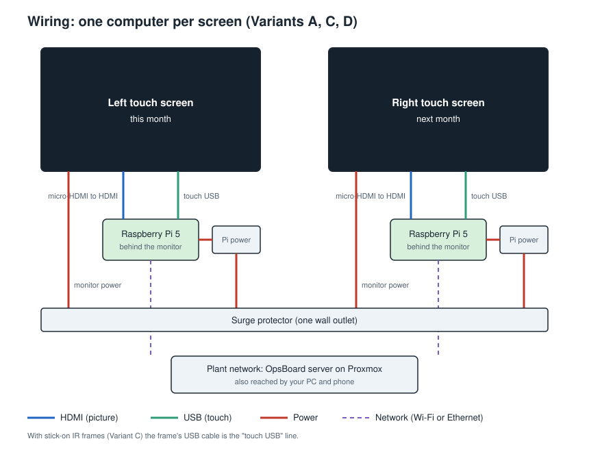
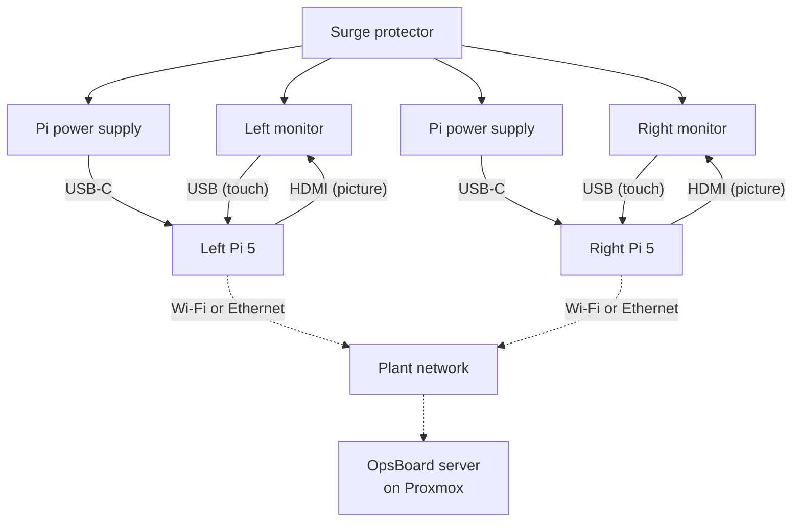

# Variant D (premium): Proxmox server, a Pi behind each screen, 43" Elo commercial touch displays

**Why this one:** two 43" screens read easily from across a room, and Elo displays are commercial signage built to
run continuously for years, with edge-to-edge glass that wipes clean.

**Trade-offs:**
- About $1,000 more than Variant A.
- Each display weighs roughly 60 lb. Two people and stud mounting are not optional.
- The E720629 model uses capacitive touch, which needs a bare finger or thin glove. The infrared model (E721186) works with any glove but was listed at $2,400 to $4,400.
- At 43" a 1080p picture is still sharp from a few feet, but up close you will see pixels.
- Prices for this display vary a lot between resellers ($1,270 open-box to $1,810). Get two quotes.

## Parts

Prices checked **November 14, 2026**. A link that goes to a search page means I could not confirm one exact product page; pick a listing with good reviews and the size shown.

| Part | Qty | Each | Total | Where |
|---|---|---|---|---|
| Elo 4303L, 43" 1080p touch display (part E720629, capacitive) | 2 | $1,500.00 | $3,000.00 | [search](https://www.cdw.com/search/?key=Elo%204303L%20E720629) |
| Raspberry Pi 5, 2 GB | 2 | $77.50 | $155.00 | [product page](https://www.raspberrypi.com/products/raspberry-pi-5/) |
| Raspberry Pi 27W USB-C power supply | 2 | $12.00 | $24.00 | [product page](https://www.raspberrypi.com/products/27w-power-supply/) |
| Raspberry Pi 5 case (has a fan) | 2 | $10.00 | $20.00 | [product page](https://www.raspberrypi.com/products/raspberry-pi-5-case/) |
| microSD card, 32 GB, A2 rated | 2 | $12.00 | $24.00 | [product page](https://www.raspberrypi.com/products/sd-cards/) |
| Micro-HDMI to HDMI cable, 1 m | 2 | $7.00 | $14.00 | [product page](https://www.raspberrypi.com/products/micro-hdmi-to-standard-hdmi-a-cable/) |
| Heavy-duty tilt wall mount, VESA up to 400x400, 80 lb or more | 2 | $50.00 | $100.00 | [search](https://www.amazon.com/s?k=tilt+tv+wall+mount+vesa+400x400+heavy+duty) |
| Surge-protector power strip, 6 outlet | 1 | $20.00 | $20.00 | [search](https://www.amazon.com/s?k=surge+protector+power+strip+6+outlet) |
| Paintable cord cover / raceway kit | 1 | $20.00 | $20.00 | [search](https://www.amazon.com/s?k=cord+cover+raceway+kit+wall) |
| Adhesive hook-and-loop strips (to fix the Pi behind the monitor) | 1 | $8.00 | $8.00 | [search](https://www.amazon.com/s?k=industrial+hook+and+loop+adhesive+strips) |
| Ethernet patch cable (optional, steadier than Wi-Fi) | 2 | $8.00 | $16.00 | [search](https://www.amazon.com/s?k=cat6+ethernet+patch+cable+10ft) |
| **Total** | | | **about $3,400** | |

## Tools

- Stud finder, pencil, 4 ft level, tape measure
- Drill with a 3/16" bit (wood studs) and a Phillips driver bit
- Socket or wrench for the lag bolts that come with the mounts
- PC with an SD card reader; USB keyboard and mouse for first setup
- A second person for hanging the screens

## Safety

- Bolt the mounts into **wall studs** (or use anchors rated for the wall type and three times the screen weight). Drywall alone will not hold a monitor.
- Check for wires and pipes before drilling. Do not drill directly above or below an outlet or switch.
- Keep the screens, power strip, and computers out of splash zones and away from chemical feed rooms. These are indoor office electronics. Chlorine and humid air corrode them.
- Plug everything into one surge protector on a normal outlet. Do not run power cords inside the wall; use the raceway on the surface, or have an electrician add an outlet behind the screens.
- Lift with two people, and never carry a monitor by its screen face.

## Wiring

## Step by step

1. Order every part in the list above. While you wait, put this repository on GitHub.
2. Install the server in a Proxmox container: [server-setup.md, option 1](server-setup.md). Write down the address, password, and screen token.
3. From your PC, open the server's web page, sign in, and set your work hours and location under **Settings**.
4. Decide the wall position. See [mounting.md](mounting.md) for the layout drawing and heights.
5. Hang both wall mounts, level with each other, following [mounting.md](mounting.md).
6. Before hanging the monitors, set up the wall-screen computer(s) on a table: follow [kiosk-setup.md](kiosk-setup.md) using `left` on one Pi and `right` on the other. It is much easier to fix a cable on a table than on the wall.
7. Confirm the calendar comes up full screen and touch works on each screen.
8. Power everything down. Attach the mount brackets to the monitors and hang them.
9. Fix each computer behind its monitor with hook-and-loop strips, clear of the vents.
10. Connect the cables as shown in the wiring diagram below, and tidy them into the raceway.
11. Power up and run the tests.

## Testing

1. Both screens show the calendar within a minute of power-on, left = this month, right = next month.
2. Tap a day on each screen, add an event with the on-screen keyboard, and see it on the web page.
3. Change the on-call name on a Thursday and confirm it fills through Wednesday.
4. Tap an arrow: both screens move together and return to today after 3 minutes.
5. Pull the power strip's plug for ten seconds and plug it back in. Everything should come back by itself.

## Calibration

- Touch accuracy, wrong-screen touch, and monitors that will not wake: see the table in [kiosk-setup.md](kiosk-setup.md).
- Brightness: set each monitor's own brightness with its buttons so the two match. Around 60 percent is comfortable indoors and extends backlight life.
- Work hours, weather station, moving effect, and GIF timing: **Settings** on the web page.

Then enter your real schedule: [using-opsboard.md](using-opsboard.md).
